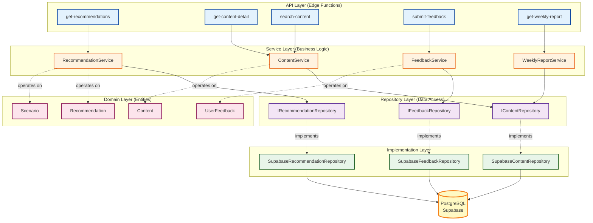
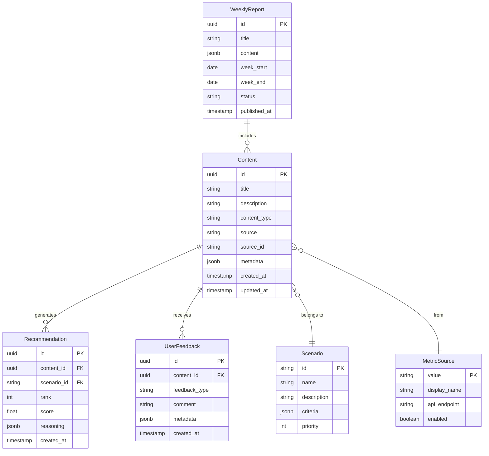
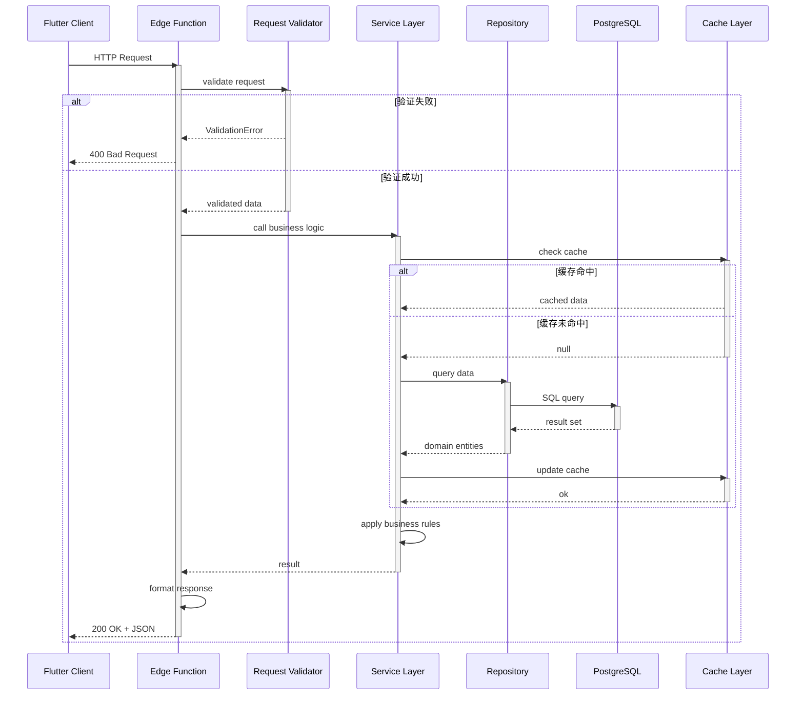
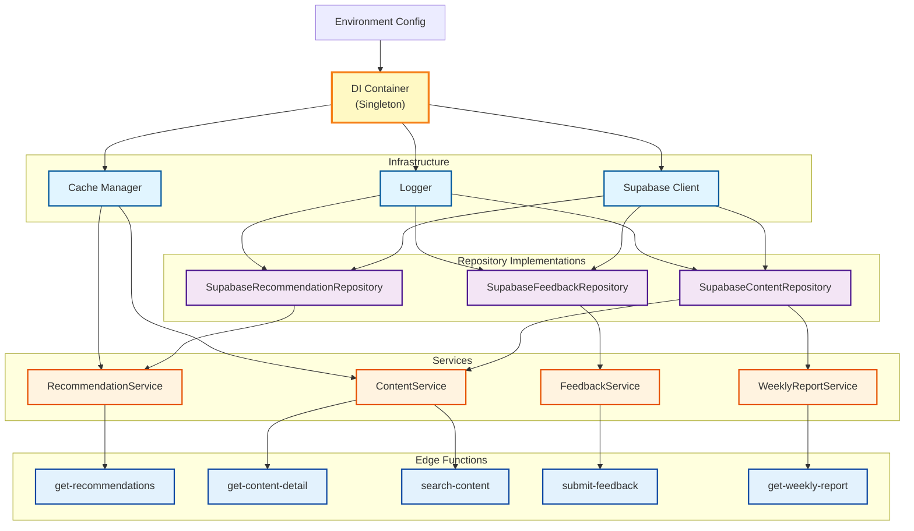
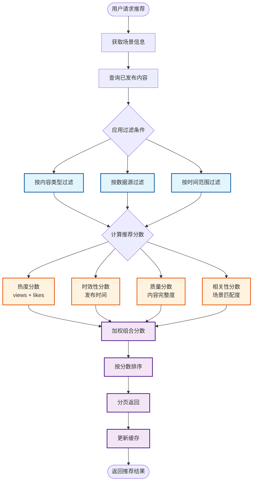
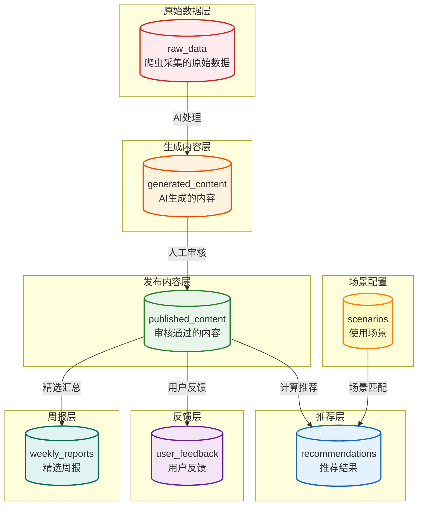
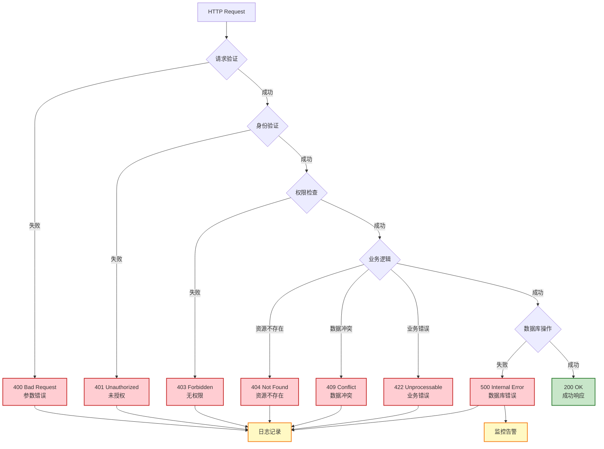
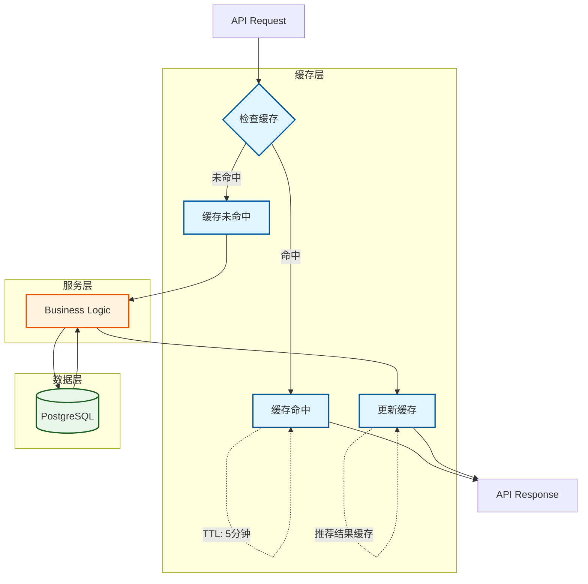
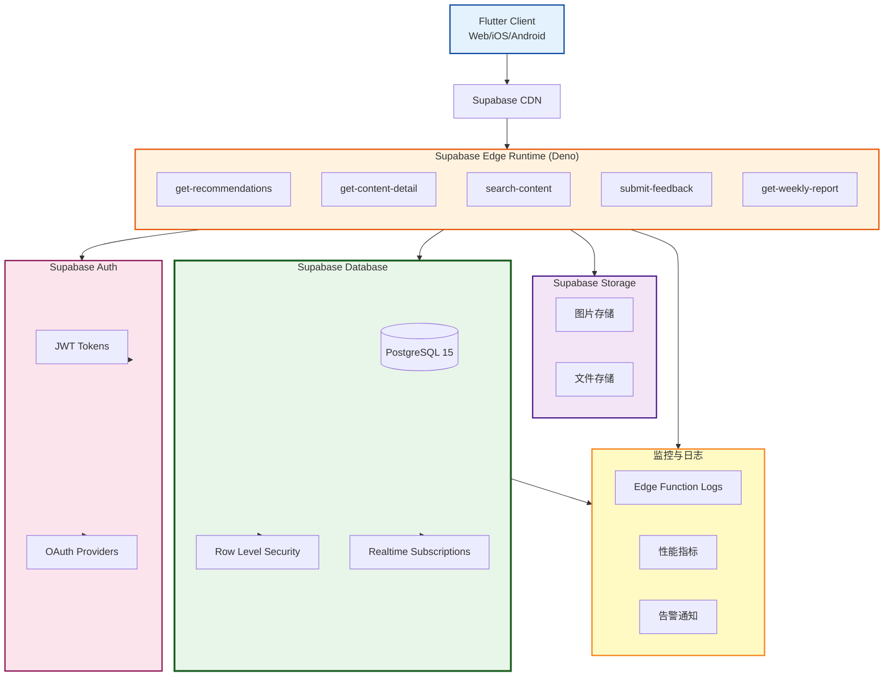
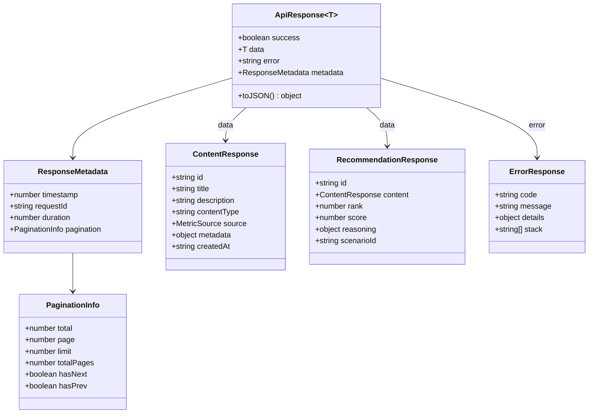

# DaCong API - 架构可视化文档

> 使用 Mermaid 图表展示后端 API 模块的架构设计

---

## 1. 分层架构图 - API → Service → Repository → Domain

---

## 2. 领域模型图 - 实体关系

---

## 3. API 调用流程图 - 请求到响应

---

## 4. 依赖注入图 - Container 管理

---

## 5. 推荐算法流程图

---

## 6. 数据库表结构图

---

## 7. 错误处理架构

---

## 8. 缓存策略架构

---

## 9. 部署架构图

---

## 10. API 响应格式标准

---

## 总结

### 架构特点

1. **分层清晰**：API → Service → Repository → Domain，职责明确
2. **依赖倒置**：服务层依赖接口，不依赖具体实现
3. **易于测试**：所有依赖可 Mock，单元测试覆盖率高
4. **类型安全**：TypeScript 强类型，Zod 运行时验证
5. **高性能**：缓存策略、批量查询、索引优化

### SOLID 原则体现

- **SRP**：每个服务只负责一个业务领域
- **OCP**：通过接口实现对扩展开放
- **LSP**：所有仓储实现可以无缝替换
- **ISP**：接口小而专注
- **DIP**：服务层依赖仓储接口

### 设计模式应用

- **Repository 模式**：隔离数据访问逻辑
- **Service 模式**：封装业务逻辑
- **DTO 模式**：数据传输对象
- **依赖注入**：Container 管理依赖
- **策略模式**：不同的推荐算法
