# DaCong Client - 架构可视化文档

> 使用 Mermaid 图表展示 Flutter 前端模块的架构设计

---

## 1. Clean Architecture 分层图

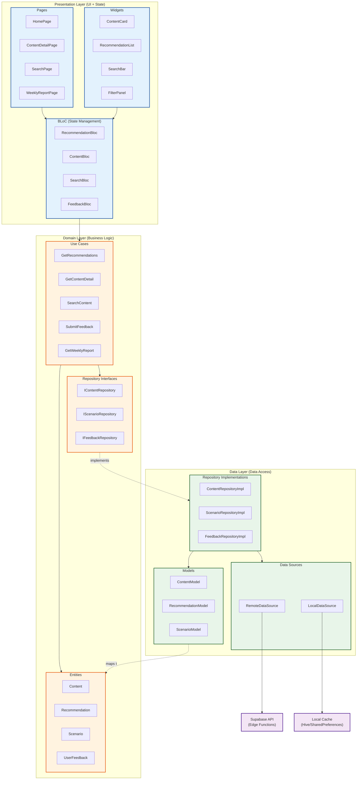

---

## 2. BLoC 状态流转图

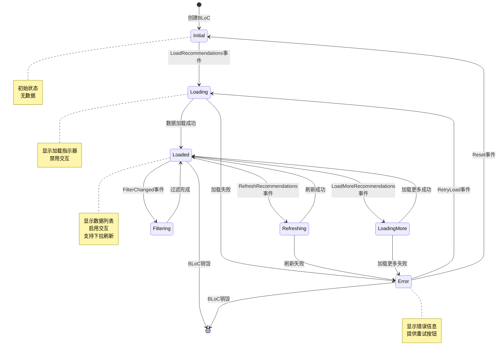

---

## 3. 数据流图 - UI → Use Case → Repository → API

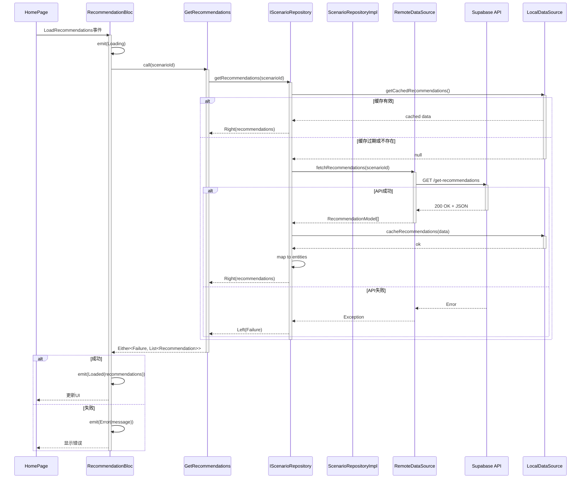

---

## 4. 页面导航图

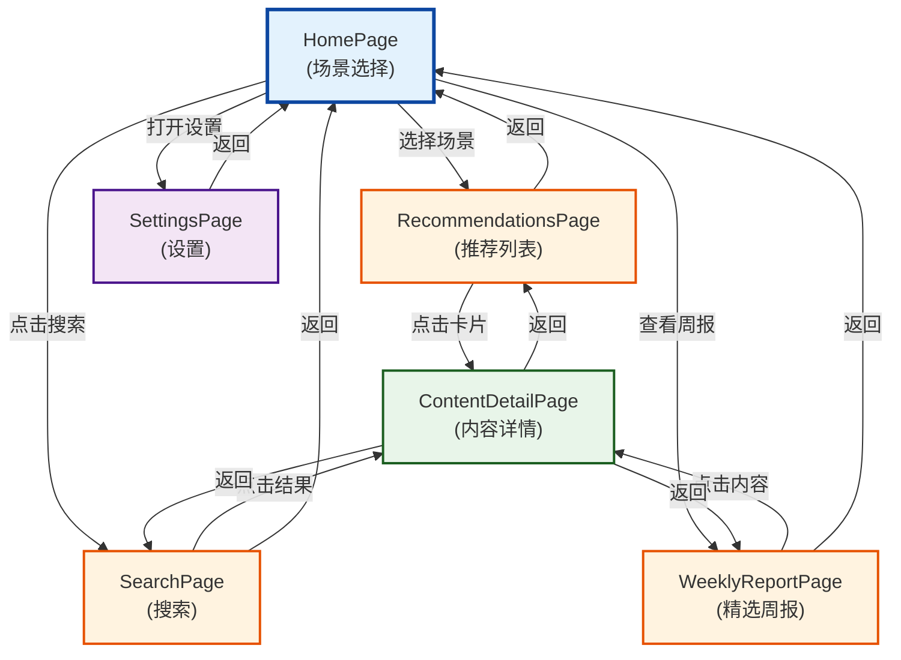

---

## 5. 依赖注入架构

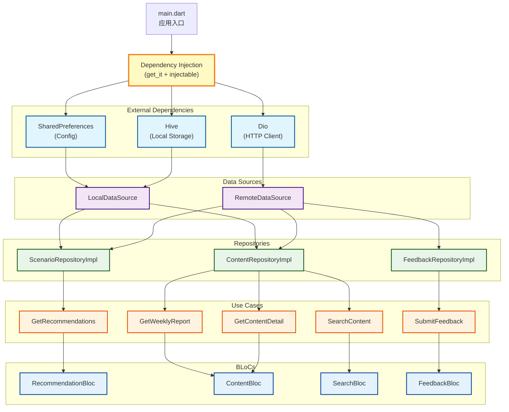

---

## 6. 错误处理架构

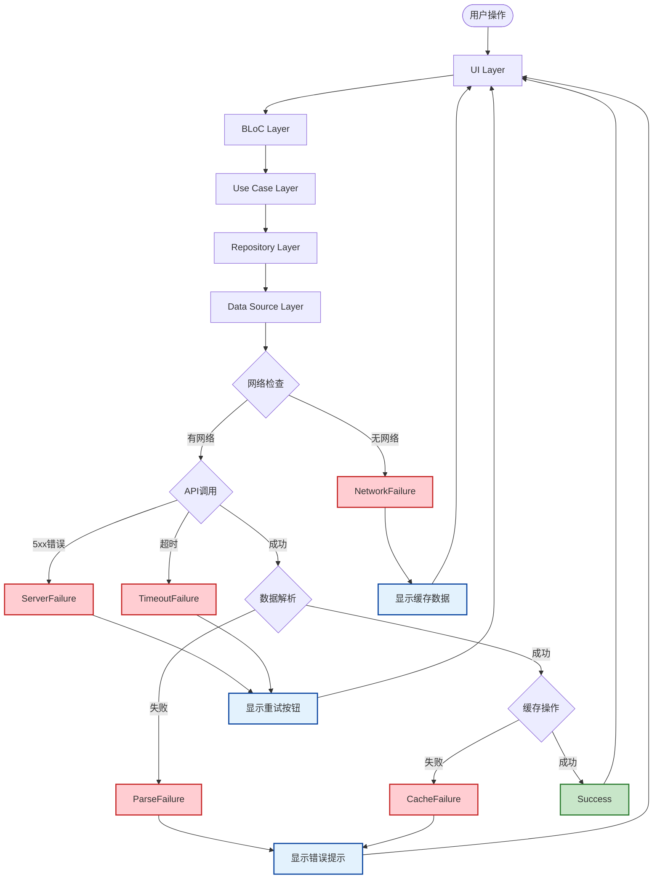

---

## 7. 缓存策略架构

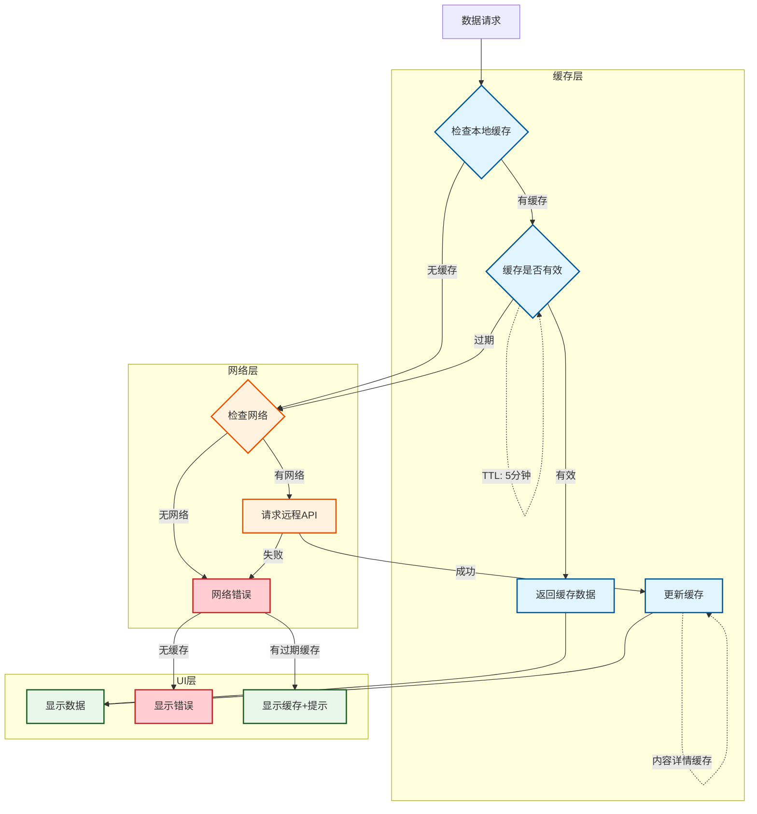

---

## 8. 响应式UI架构

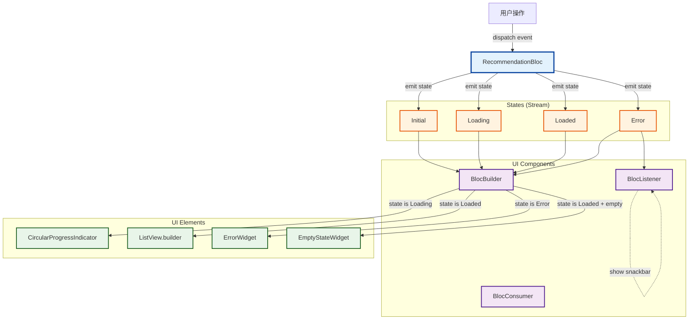

---

## 9. 国际化架构

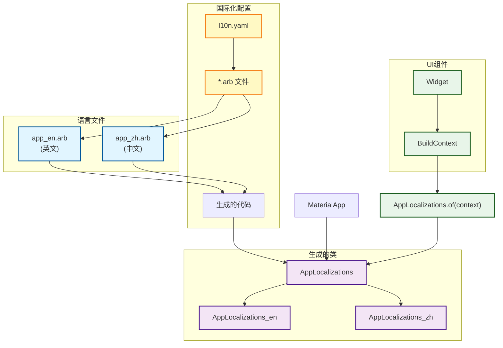

---

## 10. 主题切换架构

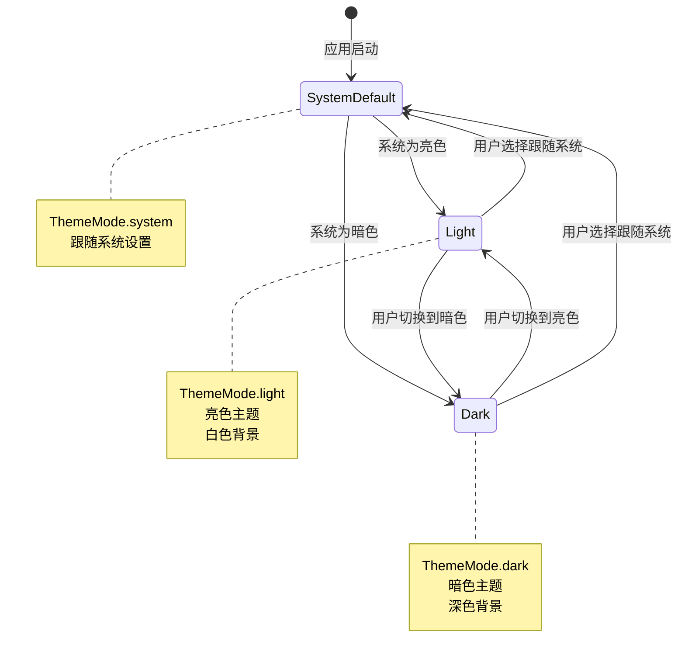

---

## 11. 性能优化架构

```mermaid
graph TB
    %% 优化策略
    subgraph Optimization["性能优化策略"]
        direction TB
        
        subgraph ListOptimization["列表优化"]
            ListView["ListView.builder<br/>(按需构建)"]
            Pagination["分页加载"]
            CachedImage["CachedNetworkImage<br/>(图片缓存)"]
        end
        
        subgraph StateOptimization["状态优化"]
            BlocSelector["BlocSelector<br/>(精确重建)"]
            EquatableState["Equatable<br/>(状态比较)"]
            ConstWidget["const Widget<br/>(避免重建)"]
        end
        
        subgraph DataOptimization["数据优化"]
            LocalCache["本地缓存"]
            Debounce["防抖搜索"]
            Prefetch["预加载数据"]
        end
        
        subgraph RenderOptimization["渲染优化"]
            RepaintBoundary["RepaintBoundary<br/>(隔离重绘)"]
            AutomaticKeepAlive["AutomaticKeepAlive<br/>(保持状态)"]
            Lazy["延迟加载"]
        end
    end
    
    %% 性能指标
    subgraph Metrics["性能指标"]
        FPS["60 FPS"]
        LoadTime["加载时间 < 1s"]
        MemoryUsage["内存占用 < 100MB"]
    end
    
    %% 关系
    ListView --> FPS
    BlocSelector --> FPS
    RepaintBoundary --> FPS
    
    LocalCache --> LoadTime
    Prefetch --> LoadTime
    
    CachedImage --> MemoryUsage
    AutomaticKeepAlive --> MemoryUsage
    
    %% 样式
    classDef optStyle fill:#e1f5ff,stroke:#01579b,stroke-width:2px
    classDef metricStyle fill:#c8e6c9,stroke:#2e7d32,stroke-width:2px
    
    class ListView,Pagination,CachedImage,BlocSelector,EquatableState,ConstWidget,LocalCache,Debounce,Prefetch,RepaintBoundary,AutomaticKeepAlive,Lazy optStyle
    class FPS,LoadTime,MemoryUsage metricStyle
```

---

## 12. 测试架构

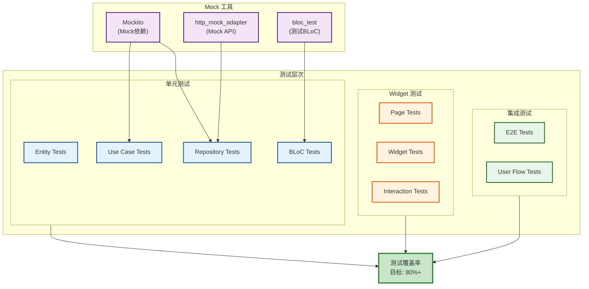

---

## 总结

### 架构特点

1. **Clean Architecture**：清晰的分层，依赖方向单一
2. **BLoC 模式**：响应式状态管理，UI 与业务逻辑分离
3. **依赖注入**：使用 get_it + injectable，易于测试
4. **类型安全**：Dart 强类型，编译时错误检查
5. **高性能**：列表优化、缓存策略、精确重建

### SOLID 原则体现

- **SRP**：每个 Use Case 只负责一个业务逻辑
- **OCP**：通过接口定义行为，扩展无需修改现有代码
- **LSP**：Repository 实现可以替换接口
- **ISP**：每个 Repository 接口只定义相关操作
- **DIP**：Use Case 依赖接口，使用依赖注入

### 设计模式应用

- **BLoC 模式**：状态管理
- **Repository 模式**：数据访问抽象
- **Use Case 模式**：业务逻辑封装
- **依赖注入**：get_it + injectable
- **观察者模式**：Stream 响应式编程
