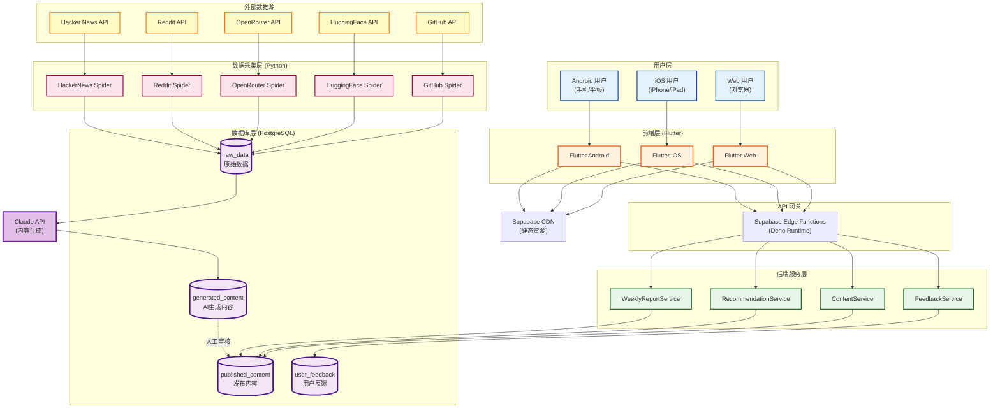
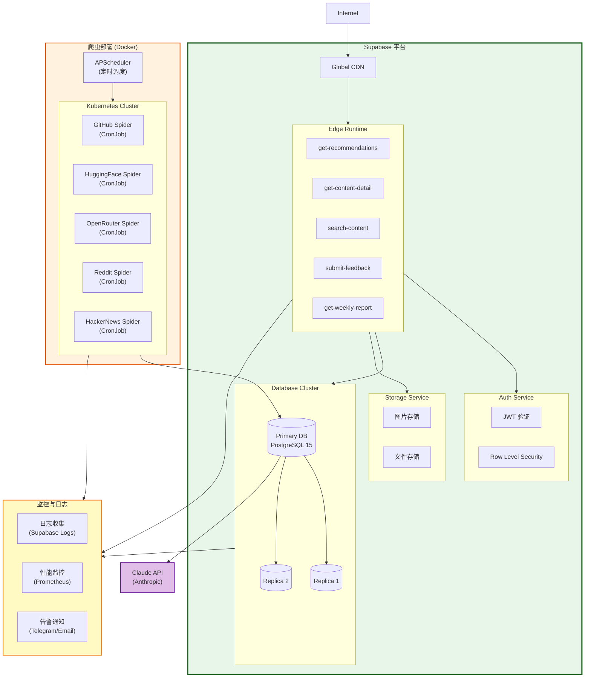
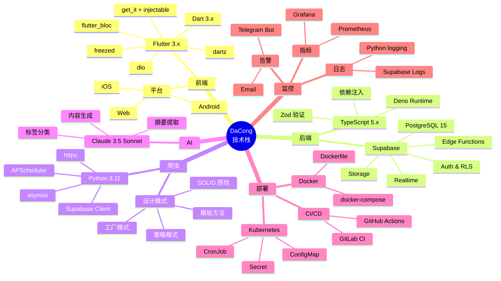
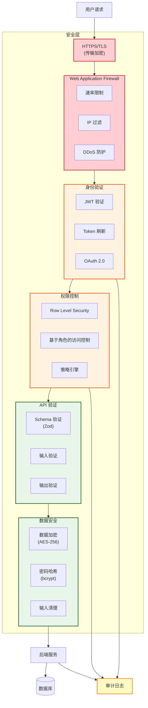
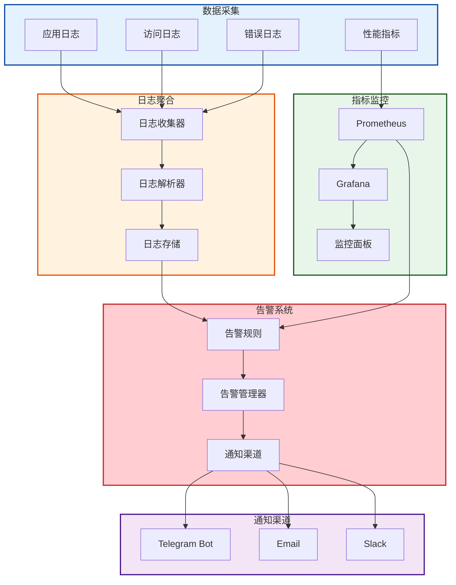
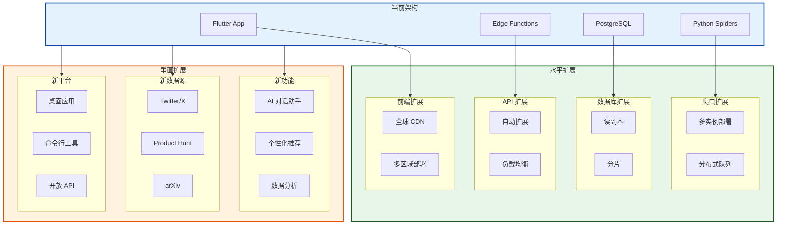
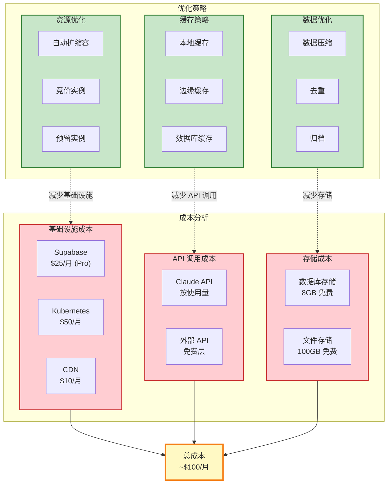

# DaCong 系统架构可视化文档

> 使用 Mermaid 图表展示整体系统架构设计

---

## 1. 系统全景图 - 用户到数据的完整流程

---

## 2. 部署架构图 - 各模块的部署方式

---

## 3. 数据流全景 - 从采集到展示

```mermaid
flowchart LR
    %% 数据采集
    subgraph Collection["1. 数据采集"]
        direction TB
        Sources["外部数据源<br/>GitHub/HF/OR/Reddit/HN"]
        Spiders["Python 爬虫<br/>(定时执行)"]
        RawDB[("raw_data")]
    end
    
    %% AI处理
    subgraph AIProcessing["2. AI 处理"]
        direction TB
        ClaudeAPI["Claude API"]
        GenDB[("generated_content")]
    end
    
    %% 人工审核
    subgraph Review["3. 人工审核"]
        direction TB
        Console["管理后台<br/>(待开发)"]
        PubDB[("published_content")]
    end
    
    %% 推荐计算
    subgraph Recommendation["4. 推荐计算"]
        direction TB
        RecService["RecommendationService"]
        RecDB[("recommendations")]
    end
    
    %% 用户展示
    subgraph Display["5. 用户展示"]
        direction TB
        API["Edge Functions"]
        Flutter["Flutter App"]
        Users["用户"]
    end
    
    %% 用户反馈
    subgraph Feedback["6. 用户反馈"]
        direction TB
        FeedbackAPI["submit-feedback"]
        FeedbackDB[("user_feedback")]
    end
    
    %% 流程
    Sources --> Spiders
    Spiders --> RawDB
    
    RawDB --> ClaudeAPI
    ClaudeAPI --> GenDB
    
    GenDB --> Console
    Console --> PubDB
    
    PubDB --> RecService
    RecService --> RecDB
    
    RecDB --> API
    API --> Flutter
    Flutter --> Users
    
    Users --> FeedbackAPI
    FeedbackAPI --> FeedbackDB
    FeedbackDB -.影响排序.-> RecService
    
    %% 样式
    classDef collectionStyle fill:#ffebee,stroke:#c62828,stroke-width:2px
    classDef aiStyle fill:#fff3e0,stroke:#e65100,stroke-width:2px
    classDef reviewStyle fill:#e8f5e9,stroke:#2e7d32,stroke-width:2px
    classDef recStyle fill:#e3f2fd,stroke:#1565c0,stroke-width:2px
    classDef displayStyle fill:#f3e5f5,stroke:#6a1b9a,stroke-width:2px
    classDef feedbackStyle fill:#fff9c4,stroke:#f57f17,stroke-width:2px
    
    class Collection collectionStyle
    class AIProcessing aiStyle
    class Review reviewStyle
    class Recommendation recStyle
    class Display displayStyle
    class Feedback feedbackStyle
```

---

## 4. 技术栈全景图

---

## 5. 安全架构图

---

## 6. 性能优化架构

```mermaid
graph TB
    %% 前端优化
    subgraph FrontendOpt["前端优化"]
        direction TB
        LazyLoad["图片懒加载"]
        CodeSplit["代码分割"]
        TreeShaking["Tree Shaking"]
        Minify["代码压缩"]
        LocalCache["本地缓存<br/>(Hive)"]
    end
    
    %% CDN优化
    subgraph CDNOpt["CDN 优化"]
        direction TB
        GlobalCDN["全球 CDN"]
        EdgeCache["边缘缓存"]
        Compression["Gzip/Brotli 压缩"]
        HTTP2["HTTP/2"]
    end
    
    %% API优化
    subgraph APIOpt["API 优化"]
        direction TB
        ResponseCache["响应缓存<br/>(5分钟)"]
        Pagination["分页加载"]
        FieldSelection["字段选择"]
        BatchRequest["批量请求"]
    end
    
    %% 数据库优化
    subgraph DBOpt["数据库优化"]
        direction TB
        Indexing["索引优化"]
        QueryOpt["查询优化"]
        ConnectionPool["连接池"]
        ReadReplica["读写分离"]
    end
    
    %% 爬虫优化
    subgraph SpiderOpt["爬虫优化"]
        direction TB
        AsyncIO["异步并发"]
        ConnReuse["连接复用"]
        BatchWrite["批量写入"]
        Incremental["增量更新"]
    end
    
    %% 性能指标
    subgraph Metrics["性能指标"]
        direction TB
        FCP["FCP < 1.5s"]
        LCP["LCP < 2.5s"]
        TTI["TTI < 3.5s"]
        API_RT["API RT < 200ms"]
        DB_RT["DB RT < 50ms"]
    end
    
    %% 关系
    FrontendOpt --> FCP
    CDNOpt --> FCP
    APIOpt --> API_RT
    DBOpt --> DB_RT
    SpiderOpt --> DB_RT
    
    FrontendOpt --> LCP
    CDNOpt --> LCP
    
    FrontendOpt --> TTI
    APIOpt --> TTI
    
    %% 样式
    classDef optStyle fill:#e1f5ff,stroke:#01579b,stroke-width:2px
    classDef metricStyle fill:#c8e6c9,stroke:#2e7d32,stroke-width:2px
    
    class FrontendOpt,CDNOpt,APIOpt,DBOpt,SpiderOpt optStyle
    class Metrics metricStyle
```

---

## 7. 监控与告警架构

---

## 8. 扩展性架构

---

## 9. 开发流程架构

```mermaid
flowchart LR
    %% 开发阶段
    subgraph Development["开发阶段"]
        direction TB
        LocalDev["本地开发"]
        UnitTest["单元测试"]
        CodeReview["代码审查"]
    end
    
    %% 构建阶段
    subgraph Build["构建阶段"]
        direction TB
        Compile["编译构建"]
        IntegrationTest["集成测试"]
        SecurityScan["安全扫描"]
    end
    
    %% 测试阶段
    subgraph Testing["测试阶段"]
        direction TB
        E2ETest["E2E 测试"]
        PerformanceTest["性能测试"]
        UAT["用户验收测试"]
    end
    
    %% 部署阶段
    subgraph Deployment["部署阶段"]
        direction TB
        Staging["预发布环境"]
        Production["生产环境"]
        Rollback["回滚机制"]
    end
    
    %% 监控阶段
    subgraph Monitoring["监控阶段"]
        direction TB
        HealthCheck["健康检查"]
        Metrics["指标监控"]
        Alerts["告警通知"]
    end
    
    %% 流程
    Development --> Build
    Build --> Testing
    Testing --> Deployment
    Deployment --> Monitoring
    Monitoring -.问题反馈.-> Development
    
    %% 样式
    classDef devStyle fill:#e3f2fd,stroke:#0d47a1,stroke-width:2px
    classDef buildStyle fill:#fff3e0,stroke:#e65100,stroke-width:2px
    classDef testStyle fill:#e8f5e9,stroke:#1b5e20,stroke-width:2px
    classDef deployStyle fill:#f3e5f5,stroke:#4a148c,stroke-width:2px
    classDef monitorStyle fill:#fff9c4,stroke:#f57f17,stroke-width:2px
    
    class Development devStyle
    class Build buildStyle
    class Testing testStyle
    class Deployment deployStyle
    class Monitoring monitorStyle
```

---

## 10. 成本优化架构

---

## 总结

### 系统特点

1. **微服务架构**：前端、后端、爬虫独立部署，松耦合
2. **云原生**：基于 Supabase 和 Kubernetes，自动扩展
3. **高可用**：数据库主从复制，API 自动扩展，CDN 加速
4. **安全可靠**：多层安全防护，审计日志，数据加密
5. **可观测性**：完善的日志、指标、告警体系

### 技术优势

- **Flutter**：一套代码，三端部署（Web/iOS/Android）
- **Supabase**：开箱即用的后端服务，降低开发成本
- **Python**：丰富的爬虫生态，易于扩展
- **Claude API**：高质量的内容生成
- **PostgreSQL**：强大的关系型数据库，支持复杂查询

### 扩展能力

- **水平扩展**：所有组件都支持水平扩展
- **垂直扩展**：易于添加新功能、新数据源、新平台
- **成本可控**：按需付费，自动扩缩容
- **性能优化**：多层缓存，CDN 加速，数据库优化

### 运维保障

- **自动化部署**：CI/CD 流程，一键部署
- **监控告警**：实时监控，及时告警
- **日志审计**：完整的日志记录，便于排查问题
- **灾难恢复**：数据备份，快速回滚

---

**文档版本**：v1.0  
**最后更新**：2026-04-17  
**维护者**：DaCong Team
