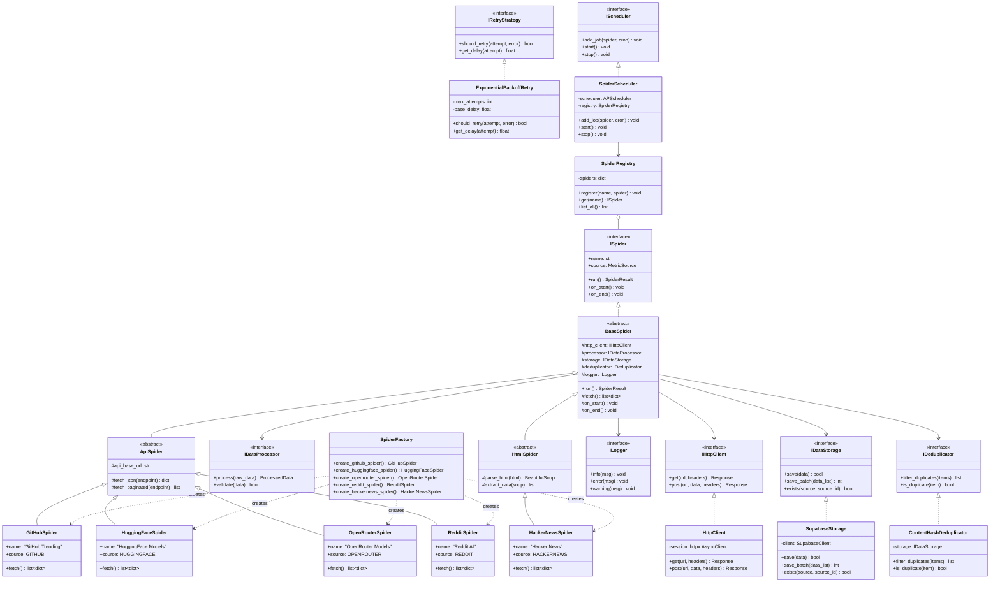
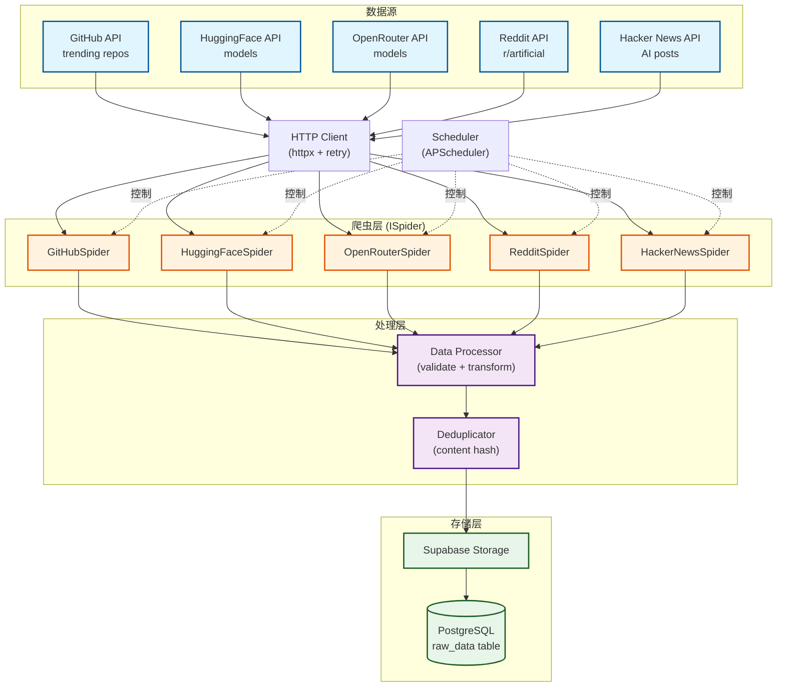
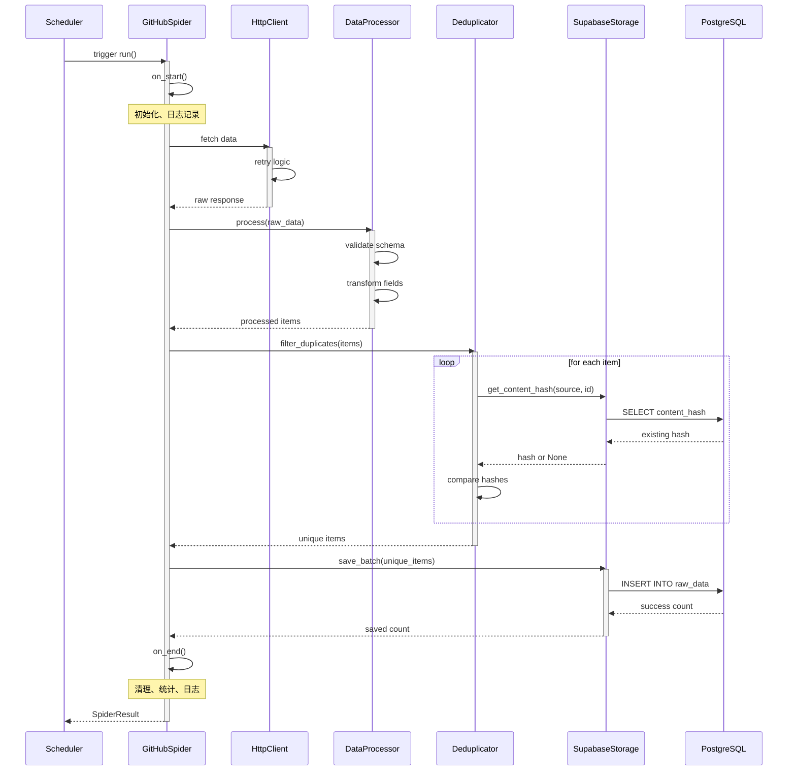
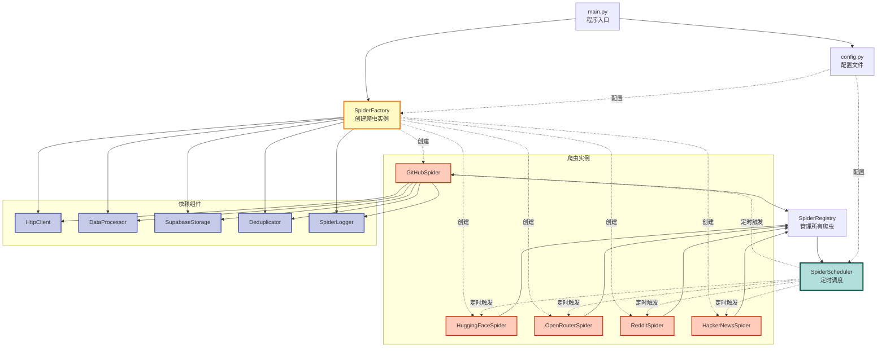
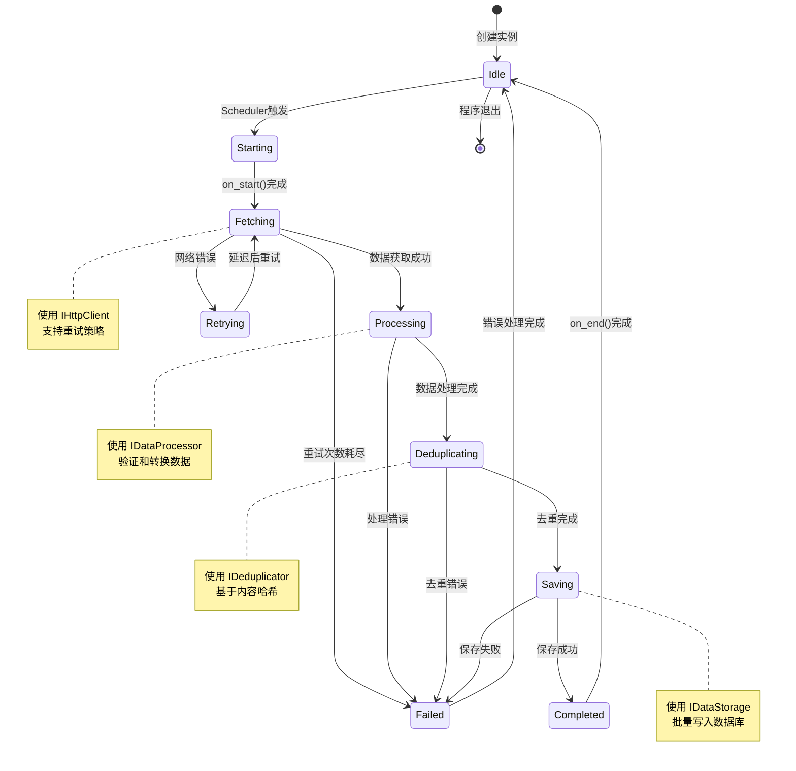
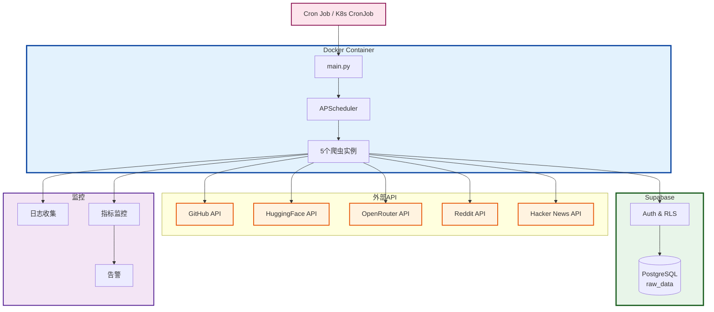
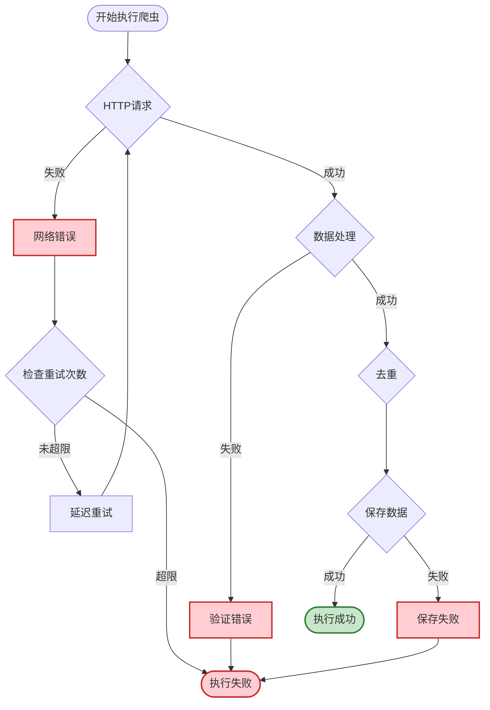
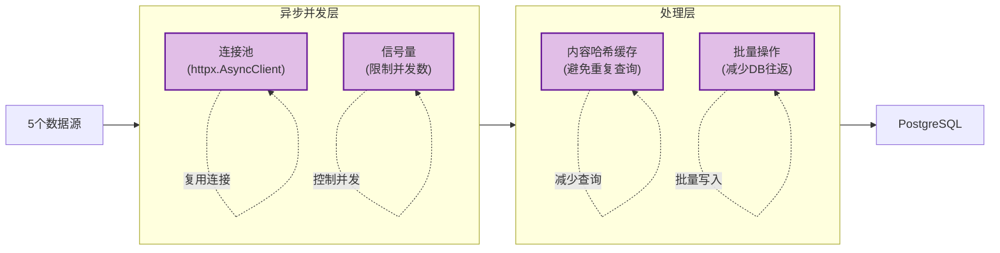

# DaCong Spider - 架构可视化文档

> 使用 Mermaid 图表展示爬虫模块的架构设计

---

## 1. 类图 - 接口与实现层次

---

## 2. 数据流图 - 从采集到存储

---

## 3. 时序图 - 爬虫执行流程

---

## 4. 组件交互图 - Factory、Scheduler、Spider

---

## 5. 状态机图 - 爬虫生命周期

---

## 6. 部署架构图

---

## 7. 错误处理流程图

---

## 8. 性能优化架构

---

## 总结

### 架构特点

1. **高度解耦**：接口层 → 基类层 → 实现层，职责清晰
2. **易于扩展**：新增爬虫只需继承基类，实现 `fetch()` 方法
3. **可测试性**：所有依赖都是接口，易于 Mock
4. **可靠性**：重试机制、去重机制、异常隔离
5. **高性能**：异步并发、连接池复用、批量操作

### SOLID 原则体现

- **SRP**：每个类只负责一个职责
- **OCP**：对扩展开放，对修改关闭
- **LSP**：子类可以替换父类
- **ISP**：接口小而专注
- **DIP**：依赖抽象，使用依赖注入

### 设计模式应用

- **模板方法模式**：BaseSpider 定义执行流程
- **策略模式**：不同爬虫是不同策略
- **工厂模式**：SpiderFactory 创建实例
- **注册表模式**：SpiderRegistry 管理爬虫
- **依赖注入**：构造函数注入所有依赖
