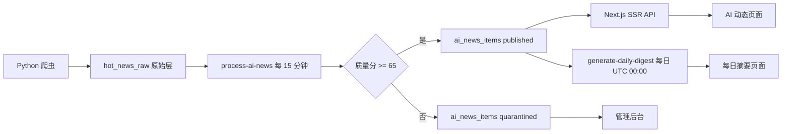

# DaCong AI 动态改造实施文档

> 状态：代码实施完成，等待生产基础设施恢复
> 更新日期：2026-09-22

## 1. 改造目标

DaCong 聚焦服务开发者和 AI 从业者，核心产品由分散榜单收敛为：

- **AI 动态**：经过规则评分、去重和来源分级的资讯流；
- **每日摘要**：每天自动选出最多 10 条高价值动态；
- **趋势信号**：保留开源项目飙升榜与模型评测脉搏；
- **管理后台**：审核隔离内容、撤回内容、启停来源、手动处理采集队列。

英文内容保留原文。摘要完全由确定性规则生成，不调用 LLM，也不需要 LLM API Key。

## 2. 系统链路

`hot_news_raw` 继续作为不可变的原始采集层。公开页面只读取精选层，避免把低质量、重复或非 AI 内容直接展示给用户。

## 3. 数据模型

迁移文件：`dacong-api/supabase/migrations/20260922_00004_ai_news_pipeline.sql`

| 表 | 用途 |
|---|---|
| `ai_source_settings` | 来源等级、默认分类和启停状态 |
| `ai_news_items` | 去重后的事件、规则摘要、质量分和发布状态 |
| `ai_news_sources` | 一个事件关联的全部原始来源 |
| `daily_digests` | 每日摘要元数据 |
| `daily_digest_items` | 摘要条目及固定排序 |

公开 RLS 仅允许读取 `published` 内容；写入和后台管理使用 service role。

## 4. 规则策略

### 4.1 分类

分类固定为 `model`、`developer_tool`、`open_source`、`research`、`industry`。先匹配标题与摘要关键词，没有命中时采用来源的默认分类。

### 4.2 质量分

质量分由四项相加并限制在 0–100：

- 来源等级：官方 40、专业媒体 30、社区 20；
- AI 相关性：最高 30；
- 新鲜度：最高 15；
- 字段完整度：最高 15。

达到 65 分自动发布，否则进入隔离区。管理员可以发布、撤回或恢复内容。

### 4.3 摘要与去重

- 中文摘要最多 150 字，其他语言最多 240 字，优先在完整句子处截断；
- 事件键由“标准化标题 + UTC 日期”计算；
- 72 小时内标题 Dice 相似度达到 0.88 时合并来源；
- 已撤回事件即使再次采集也保持撤回状态；
- 每日摘要最多 10 条，同一分类最多 3 条，按重要度、质量分和发布时间确定性排序。

## 5. Web 与管理入口

| 路径 | 功能 |
|---|---|
| `/web/dynamics` | 精选/最新切换、分类筛选、飙升榜、模型脉搏 |
| `/web/dynamics/[id]` | 动态详情与多来源链接 |
| `/web/digests` | 每日摘要列表 |
| `/web/digests/[date]` | 指定日期摘要 |
| `/admin/dynamics` | 隔离审核、发布/撤回、来源开关、处理采集队列 |

Next.js 已切换为 Vercel SSR，动态 API 不再在构建时冻结为静态 JSON。

## 6. 调度与部署

1. 在 Supabase 控制台恢复项目；
2. 执行 `supabase db push --workdir dacong-api`；
3. 部署 `process-ai-news` 与 `generate-daily-digest`；
4. 在 Vault 创建 `project_url`、`service_role_key`，执行 `dacong-api/supabase/deploy-cron-ai-news.sql`；
5. 在 Vercel 配置 `NEXT_PUBLIC_SUPABASE_URL`、`NEXT_PUBLIC_SUPABASE_ANON_KEY`、`SUPABASE_SERVICE_ROLE_KEY`；
6. 部署 `dacong-console`，检查动态列表、详情、日报和后台；
7. 手动调用一次处理函数和日报函数，验证首批生产数据。

当前生产发布尚未执行：Supabase 项目处于暂停状态，且本机 Vercel CLI 登录凭据已失效。代码、迁移和调度文件已经准备完成，恢复这两项后即可按上述步骤发布。

## 7. 验收标准

- Edge Function 规则测试、类型检查全部通过；
- 爬虫全量测试通过；
- Next.js 生产构建通过，动态 API 均标记为运行时路由；
- 公开 API 不返回隔离或撤回内容；
- 同一事件的多个来源聚合为一条动态；
- 每日摘要重复执行结果稳定且不会产生重复记录；
- 生产环境完成迁移、函数、调度、页面及首批数据冒烟验证。
