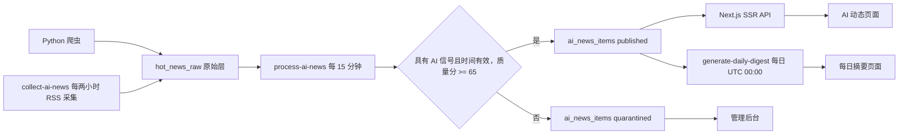

# DaCong AI 动态改造实施文档

> 状态：生产部署、RSS 自动采集、处理与日报调度完成；GitHub 推送等待仓库权限
> 更新日期：2026-10-22

## 1. 改造目标

DaCong 聚焦服务开发者和 AI 从业者，核心产品由分散榜单收敛为：

- **AI 动态**：经过规则评分、去重和来源分级的资讯流；
- **每日摘要**：每天自动选出最多 10 条高价值动态；
- **趋势信号**：保留开源项目飙升榜与模型评测脉搏；
- **管理后台**：审核隔离内容、撤回内容、启停来源、手动处理采集队列。

已有完整中文译文的资讯默认显示中文，可逐条点击“查看原文”与“翻译成中文”切换。原始短摘要由确定性规则生成；新增英文资讯由 MyMemory 在匿名免费额度内自动翻译，不需要 LLM API Key。

## 2. 系统链路

`hot_news_raw` 继续作为不可变的原始采集层。公开页面只读取精选层，避免把低质量、重复或非 AI 内容直接展示给用户。

## 3. 数据模型

迁移文件：`dacong-api/supabase/migrations/20260922_00004_ai_news_pipeline.sql`

| 表 | 用途 |
|---|---|
| `ai_source_settings` | 来源等级、默认分类和启停状态 |
| `ai_news_items` | 去重后的事件、规则摘要、质量分和发布状态 |
| `ai_news_sources` | 一个事件关联的全部原始来源 |
| `daily_digests` | 每日摘要元数据 |
| `daily_digest_items` | 摘要条目及固定排序 |

公开 RLS 仅允许读取 `published` 内容；写入和后台管理使用 service role。

## 4. 规则策略

### 4.1 分类

分类固定为 `model`、`developer_tool`、`open_source`、`research`、`industry`。先匹配标题与摘要关键词，没有命中时采用来源的默认分类。

### 4.2 质量分

质量分由四项相加并限制在 0–100：

- 来源等级：官方 40、专业媒体 30、社区 20；
- AI 相关性：最高 30；
- 新鲜度：最高 15；
- 字段完整度：最高 15。

标题与摘要须具有明确 AI 信号，发布时间不能在未来，并达到 65 分才自动发布，否则进入隔离区。来源标记 `is_ai_related=true` 本身不足以通过筛选。管理员可以发布、撤回或恢复内容。

### 4.3 摘要与去重

- 中文摘要最多 150 字，其他语言最多 240 字，优先在完整句子处截断；
- 事件键由“标准化标题 + UTC 日期”计算；
- 有效的原始发布时间优先于采集时间；原始日期缺失或无效时回退到采集时间；
- 72 小时内标题 Dice 相似度达到 0.88 时合并来源；
- 已撤回事件即使再次采集也保持撤回状态；
- 每日摘要最多 10 条，同一分类最多 3 条，按重要度、质量分和发布时间确定性排序。

## 5. Web 与管理入口

| 路径 | 功能 |
|---|---|
| `/web/dynamics` | 中英文搜索、精选/最新切换、分类与时间筛选、加载更多、刷新与失败重试、飙升榜、模型脉搏 |
| `/web/dynamics/[id]` | 动态详情与多来源链接 |
| `/web/digests` | 每日摘要列表 |
| `/web/digests/[date]` | 指定日期摘要 |
| `/admin/dynamics` | 隔离审核、发布/撤回、来源开关、处理采集队列 |

Next.js 已切换为 Vercel SSR，动态 API 不再在构建时冻结为静态 JSON。

## 6. 调度与部署

本次已恢复 Supabase 项目 `prszkdbdgffbdqclbgol`，保留原有数据，并完成以下配置：

1. 按 `dacong-api/supabase/deploy-ai-dynamics-production.sql` 中的顺序，在同一事务中对齐历史表结构并应用动态、日报和权限迁移；迁移登记为 `ai_dynamics_bootstrap_20261002`。历史库的迁移记录不完整，不直接执行全部遗留迁移。
2. 部署 `collect-ai-news`、`process-ai-news` 与 `generate-daily-digest`；配置 Edge Function Secret `AI_NEWS_SERVICE_ROLE_KEY`，使函数使用当前有效的服务端凭据。采集函数现已包含 Anthropic 官方新闻页适配。
3. 配置 Vault 的 `project_url`、`service_role_key`，启用每两小时的第 17 分钟采集任务、每 15 分钟处理任务及每日 UTC 00:00（北京时间 08:00）日报任务；HTTP 调用超时设为 60 秒。
4. 在 Vercel 配置 `NEXT_PUBLIC_SUPABASE_URL`、`NEXT_PUBLIC_SUPABASE_ANON_KEY`、`SUPABASE_URL`、`SUPABASE_SERVICE_ROLE_KEY`；项目 Root Directory 为 `dacong-console`，Framework 为 Next.js。
5. 完成生产构建与部署，入口为 [AI 动态](https://dacong-weld.vercel.app/web/dynamics) 和 [每日摘要](https://dacong-weld.vercel.app/web/digests)。

首次运行发布 10 条动态、隔离 1 条内容。2026-10-02 按网络动态扩充 RSS 并复核原始日期和相关性后，当前发布 63 条、隔离 31 条；该日日报重新生成后为 4 条过去 24 小时的精选。6 个 RSS 来源采集成功，VentureBeat 返回 HTTP 429。详见 [热点与体验调整记录](AI_DYNAMICS_HOTSPOT_UPDATE.md)。

RSS 自动采集已改由 Supabase Edge Function 与 pg_cron 独立运行，不依赖 GitHub。GitHub 工作流 `.github/workflows/ai-news-update.yml` 保留用于 Python 采集与扩展来源；前端发布工作流已改为 Vercel。当前 GitHub token 无法访问仓库推送和 Actions Secrets，相关提交仍保留在本地，GitHub 工作流尚未启用。启用时需要仓库 Contents、Workflows 及 Secrets 读写权限，并配置 `SUPABASE_URL`、`SUPABASE_SERVICE_ROLE_KEY`、`VERCEL_TOKEN`、`VERCEL_ORG_ID`、`VERCEL_PROJECT_ID`。

后台需要应用用户在 `profiles` 中具备管理员角色；本次未将任何已有用户自动提升为管理员。凭据仅配置在平台环境变量、Secrets 和 Vault 中，不写入本文件。

## 7. 验收标准

- Edge Function 规则测试、类型检查全部通过；
- 爬虫全量测试通过；
- Next.js 生产构建通过，动态 API 均标记为运行时路由；
- 公开 API 不返回隔离或撤回内容；
- 同一事件的多个来源聚合为一条动态；
- 每日摘要重复执行结果稳定且不会产生重复记录；
- 生产环境完成迁移、函数、调度、页面及首批数据冒烟验证。

本次验证：Edge Function 规则测试 7 项通过，相关爬虫测试 35 项通过，相关 Web 测试 41 项通过，局部 ESLint 与 Next.js 本地及 Vercel 生产构建通过。全量测试仍有原有失败：爬虫 3 项依赖未配置的 LLM API Key，Web 10 项性能测试依赖本地运行服务、1 项评论分页断言与实现不一致。构建还提示旧榜单缺少部分表或列，这不阻断本次动态与日报发布。

生产冒烟验证通过：动态页面、日报页面、列表/详情/日报 API 返回 HTTP 200；公开列表为 10 条已发布内容，日报为 8 条已发布内容；未登录请求管理 API 返回 HTTP 401。重复执行处理函数新增条目为 0，日报仍为 8 条。Supabase 状态为 `ACTIVE_HEALTHY`，两个 cron 任务均处于启用状态。

## 8. 原文与中文译文切换

动态列表、详情和日报条目有完整译文时默认显示中文，点击“查看原文”仅切换当前条目，再次点击“翻译成中文”恢复中文。暂无完整译文时显示原文，来源链接始终保留。

迁移 `20261002_00006_ai_news_chinese.sql` 增加可空的 `title_zh`、`summary_zh` 字段；原始内容、语言标记和去重字段不变。首批 10 条公开动态及 1 条隔离内容的译文已补齐。译文随公开 API 返回，点击切换无需额外网络请求；没有完整译文的条目保持原文显示。

`translate-ai-news` 已使用 MyMemory 匿名 API，每 15 分钟处理最多 2 条缺少译文的已发布英文资讯并逐条保存；后续条目失败时保留已完成结果。官方来源接入、免费额度与验证结果详见 [官方动态采集与自动翻译](AI_NEWS_TRANSLATION.md)。

## 9. Android 同步

Android 1.1.2 使用加载同一生产站点的原生 WebView 客户端，共享 AI 动态、日报、搜索与分页及原文/中文切换功能，页面更新无需重打 APK。构建、导航处理和安装验证说明见 [Android AI 动态同步](ANDROID_AI_DYNAMICS.md)。

## 10. 搜索与连续阅读

资讯流支持提交中英文关键词，匹配原文和中文译文的标题、摘要，可与分类、时间范围及精选/最新排序组合使用。关键词最多 120 字符，清空搜索后回到当前筛选下的完整列表。

首屏读取 30 条，有后续内容时提供“加载更多”；刷新读取当前查询的第一页。加载更多失败保留已读列表并提供重试，筛选变化时取消旧请求，防止迟到结果混入新列表。

API 使用 `q` 传入关键词，`meta.nextCursor` 为客户端应原样回传的分页游标。排序末尾增加唯一 ID 作为同分、同时间的排序依据，避免同一发布时间的资讯被跳过；额外查询一条用于判断是否真的存在下一页。公开查询仍限定已发布内容。
